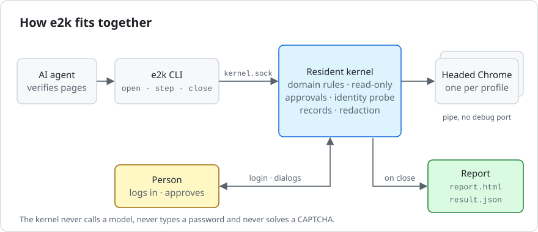
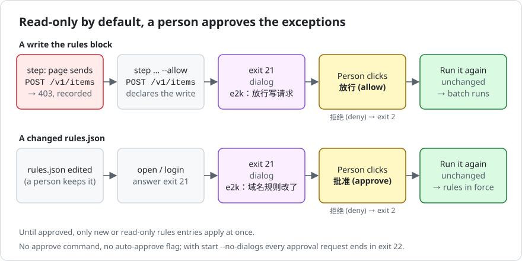
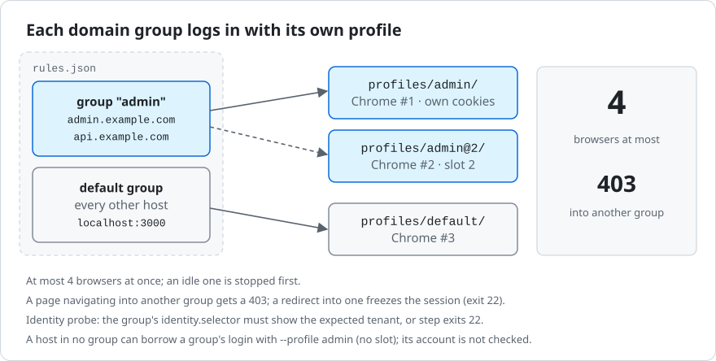
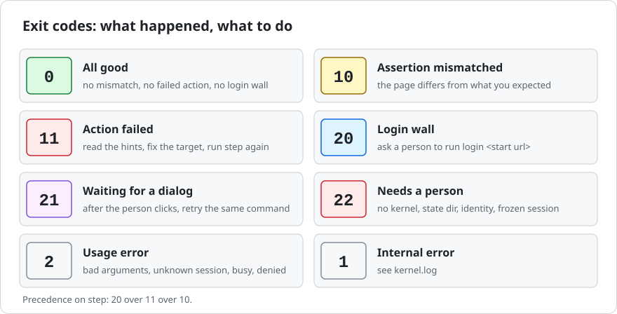

# e2e-kernel

**English** | [简体中文](README.zh-CN.md)

A local resident kernel plus an `e2k` CLI that lets an AI agent do e2e verification in a real browser. The kernel owns a headed Chromium, keeps sessions alive across CLI calls, records what the agent did and what the page did, and writes a report for a person to read.

It does not call a model, does not type passwords and does not solve CAPTCHAs: **a person logs in, the agent verifies.**

- **Real, headed browser**: Chromium driven by Playwright, one browser per login profile.
- **Read-only where you say so**: `rules.json` marks hosts read-only; writes there are blocked and recorded.
- **A person approves the exceptions**: rule changes and declared writes wait for a click in a native dialog. There is no `approve` command.
- **Deny where it matters**: a host marked `deny` (in `rules.json`, or chosen by a person at the first `login` on a new host) cannot be opened by an agent on its own; every run needs a person's approval ([Deny mode](docs/reference.md#deny-mode)).
- **Save a run as a case and replay it**: `save-case` exports a replayable case file from a closed session, `run` replays it without an agent ([Cases](docs/reference.md#cases)).
- **An MCP shell**: `e2k mcp` serves the same commands over stdio for agents that prefer MCP; it has no login, rule-editing or approval tool ([MCP shell](docs/reference.md#mcp-shell)).
- **A report for people**: every session ends in `report.html` and `result.json`, redacted.

If you are an AI agent, read [docs/agent-guide.md](docs/agent-guide.md) first. The full reference is [docs/reference.md](docs/reference.md).



## Quick start

macOS with a graphical login session (the browser is always headed) and Node >= 24.12.

```sh
npm install                     # also builds dist/ through the prepare script
npx playwright install chromium
node bin/e2k.js start           # the kernel runs in the foreground; Ctrl-C stops it
```

In another terminal (or from the agent):

```sh
node bin/e2k.js open http://localhost:3000/ --name smoke
node bin/e2k.js step s-1a2b3c '[{"op":"click","target":"e7"},{"op":"assert","kind":"text","target":"#status","cmp":"eq","expected":"Saved"}]'
node bin/e2k.js close s-1a2b3c --verdict pass --because "the item list grew by one"
```

`open` returns a session id and a first snapshot with refs (`e7`); `step` runs a JSON batch of up to 50 operations; `close` writes the report under `~/.e2e-kernel/runs/`. A person signs in with `node bin/e2k.js login <url>`. Other commands: `save-case`, `run`, `mcp`, `status`, `doctor`, `rule list`, `rule diff`, `help`. After `npm link` you can type `e2k <command>`; run `npm run build` after changing the source.

## Read-only mode and approvals



A session is read-only when `open --readonly` forces it or a rule marks its host `readonly`. Only reads pass (GET, HEAD, OPTIONS, a strict GraphQL query); everything else is blocked with a 403 and recorded. When a check really needs a write, the agent declares it with `step --allow` and a person approves it. A changed `rules.json` only takes effect once a person approves it, too. Details: [Read-only mode](docs/reference.md#read-only-mode), [Allowing writes](docs/reference.md#allowing-writes-on-read-only-hosts), [Domain rules](docs/reference.md#domain-rules).

## Deny mode

A host is `deny` when a rule says so (`{"match": "admin.example.com", "mode": "deny"}`) or when a person picks 「不允许」 in the two-step dialog at the first `login` on a host no rule covers. Opening it, logging in there, borrowing a group that contains it and declaring a write against it each wait for a person's click in a dialog, every run; an approval not used within 5 minutes expires and none is remembered. Without one, a navigation into the host is aborted and a request to it gets a 403. Not covered: WebSockets and the follow-up hops of a redirect (Playwright only routes the first hop), so deny is a guard against an agent that drifts, not a sandbox. Details: [Deny mode](docs/reference.md#deny-mode), [Known gaps](docs/reference.md#known-m1-gaps).

## Cases and the MCP shell

```sh
node bin/e2k.js save-case s-1a2b3c --out ~/cases/smoke.json   # after close; marks steps that cannot be replayed
node bin/e2k.js run ~/cases/smoke.json                         # replays it, no agent needed, writes a new report
claude mcp add e2k -- node <repo>/bin/e2k.js mcp               # or point any MCP client at `node <repo>/bin/e2k.js mcp`
```

A case file holds the start URL, profile, viewport, the replayable steps and the write declarations; it carries site information, so keep it outside this repository. The MCP shell offers `open`, `step`, `close`, `run`, `save_case`, `status`, `doctor` and `rule_list`; logging in, changing rules and approving stay with the person. Details: [Cases](docs/reference.md#cases), [MCP shell](docs/reference.md#mcp-shell).

## Domain groups and profiles



Groups in `rules.json` give their hosts their own browser profile (own cookies, own login), so two accounts never share a browser. An optional identity probe checks that the page shows the expected tenant. Details: [Profiles](docs/reference.md#profiles), [Identity probe](docs/reference.md#identity-probe).

## Exit codes



Full table: [Exit codes](docs/reference.md#exit-codes).

## Safety, in short

The kernel never types a password (`fill` refuses password-like fields), redacts tokens, e-mail addresses and credentials in output and reports, and opens no debugging port. It guards against an agent that drifts, misclicks or takes shortcuts, not against a deliberately hostile one. Never edit `rules.json` or `approvals.json` from an agent, and never use automation to click an approval dialog. Details: [Safety](docs/reference.md#safety), [Threat model](docs/reference.md#threat-model), [Known M1 gaps](docs/reference.md#known-m1-gaps).

## Status and documents

Status: M3 (kernel, CLI, read-only mode, approvals, domain groups and profiles, identity probe, foreground handed back, `deny` mode, `save-case` / `run`, an MCP shell). Running Claude Code and Codex CLI through the MCP shell is still a manual acceptance step; see [MCP shell](docs/reference.md#mcp-shell) and [Not in this version](docs/reference.md#not-in-this-version).

| document | what it is |
|---|---|
| [docs/agent-guide.md](docs/agent-guide.md) | short guide for agents: commands, fields, exit codes (Chinese) |
| [docs/reference.md](docs/reference.md) | full reference: every command, operation, rule, approval, safety boundary and known gap |
| [docs/design.md](docs/design.md) | design and milestones (Chinese) |
| [docs/m0-findings.md](docs/m0-findings.md) | measurements behind the design (Chinese) |

The CLI messages, the text output and `report.html` are in Chinese; field names, op names, `--json` output and exit codes are language-neutral.

## Development

```sh
npm run check         # fast, no browser: typecheck, unit and kernel tests, public-repo scan
npm run check:all     # check, then the headed-Chromium tests (test:browser, test:e2e); run before a PR
npm run test:browser  # driver tests in a real headed Chromium
npm run test:e2e      # build, then end-to-end acceptance on local fixtures
npm run m0            # route-coverage and worker probes; results are described in docs/m0-findings.md
```

`npm run check:public` (part of `check`) reads a word list that lives outside the repository (set `E2K_PUBLICITY_WORDS`; the default is `~/.config/e2e-kernel/publicity-words.txt`) and needs a repository-local `user.name` and `user.email`; without them it exits 2, and so does `check`. To run only the tests, use `npm run typecheck && npm test`.

The diagrams under `docs/img/` are plain SVG files with a light and a dark palette.

License: MIT.
