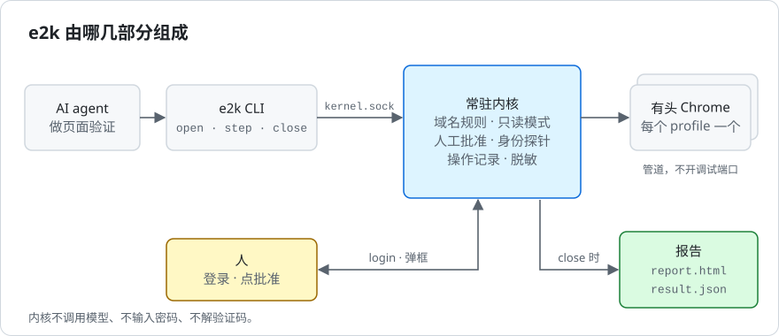
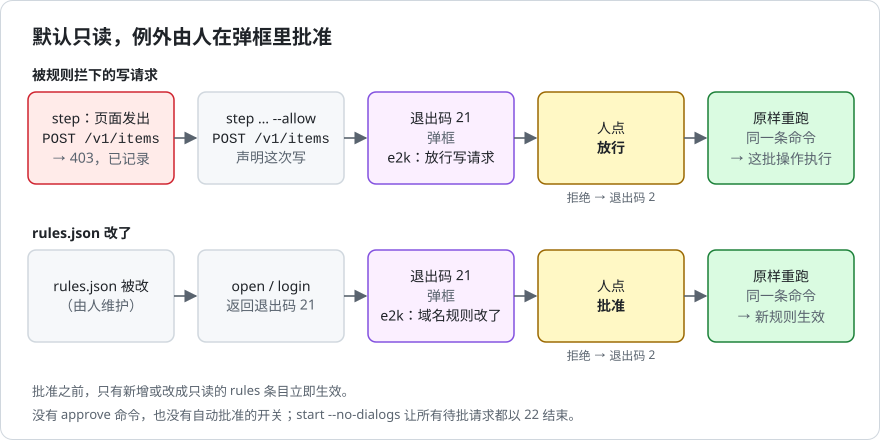
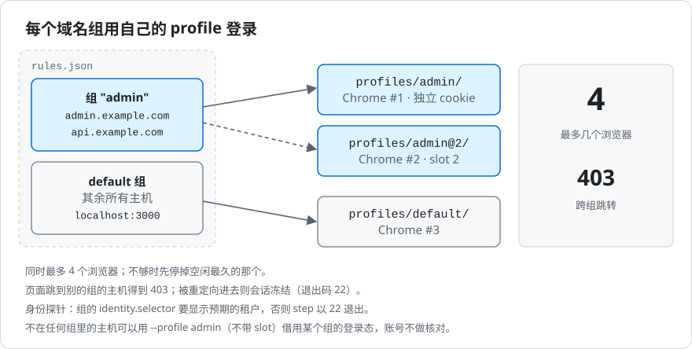
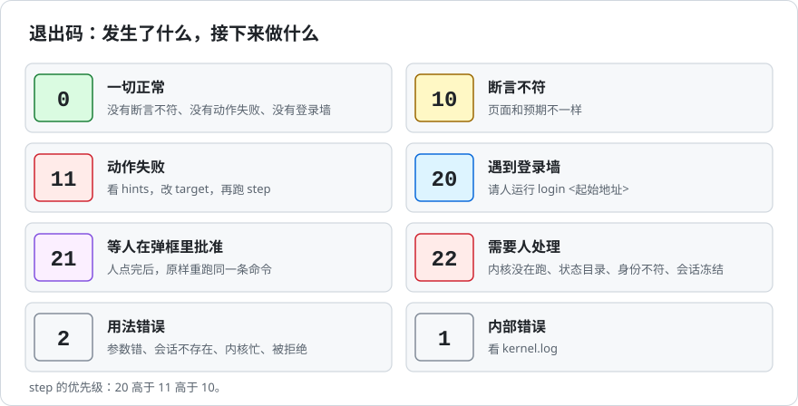

# e2e-kernel

[English](README.md) | **简体中文**

一个本机常驻的内核加一个 `e2k` 命令行，让 AI agent 在真实浏览器里做 e2e 验证。内核持有一个有头 Chromium，让会话跨多次 CLI 调用保持，记下 agent 做了什么、页面做了什么，最后写一份给人看的报告。

它不调用模型、不输入密码、不解验证码：**人来登录，agent 来验证。**

- **真实的有头浏览器**：由 Playwright 驱动的 Chromium，每个登录 profile 一个浏览器。
- **你说只读就只读**：`rules.json` 把主机标成只读，在那里的写请求被拦下并记录。
- **例外由人批准**：规则改动和声明要放行的写，都要等人在原生弹框里点一下。没有 `approve` 命令。
- **要紧的域名可以设成不允许**：标成 `deny` 的主机，agent 不能自己打开，每次运行都要人批准（见 [Deny mode](docs/reference.md#deny-mode)）。
- **存成用例，重跑**：`save-case` 把已 close 的会话导出成可重放的用例文件，`run` 不需要 agent 在场就能重跑（见 [Cases](docs/reference.md#cases)）。
- **MCP 外壳**：`e2k mcp` 经标准输入输出提供同样的命令，给偏好 MCP 的 agent 用；没有登录、改规则和批准类工具（见 [MCP shell](docs/reference.md#mcp-shell)）。
- **给人看的报告**：每个会话结束时生成 `report.html` 和 `result.json`，已脱敏。

如果你是 AI agent，先读 [docs/agent-guide.md](docs/agent-guide.md)。完整参考见 [docs/reference.md](docs/reference.md)（英文）。



## 快速上手

需要 macOS 图形登录会话（浏览器总是有头的）和 Node >= 24.12。

```sh
npm install                     # 会经 prepare 脚本顺带构建 dist/
npx playwright install chromium
node bin/e2k.js start           # 内核在前台运行；Ctrl-C 停止
```

在另一个终端（或由 agent）运行：

```sh
node bin/e2k.js open http://localhost:3000/ --name smoke
node bin/e2k.js step s-1a2b3c '[{"op":"click","target":"e7"},{"op":"assert","kind":"text","target":"#status","cmp":"eq","expected":"Saved"}]'
node bin/e2k.js close s-1a2b3c --verdict pass --because "the item list grew by one"
```

`open` 返回会话 id 和带引用（`e7`）的第一份快照；`step` 执行一批 JSON 操作，一次最多 50 个；`close` 把报告写到 `~/.e2e-kernel/runs/` 下。人用 `node bin/e2k.js login <url>` 登录。其他命令：`save-case`、`run`、`mcp`、`status`、`doctor`、`rule list`、`rule diff`、`help`。`npm link` 之后可以直接写 `e2k <命令>`；改了源码要跑 `npm run build`。

## 只读模式与人工批准



`open --readonly` 强制只读，或规则把会话所在主机标成 `readonly` 时，会话就是只读的。只有读请求能过（GET、HEAD、OPTIONS、严格的 GraphQL query），其余一律以 403 拦下并记录。验证确实需要一次写时，agent 用 `step --allow` 声明，由人批准。`rules.json` 改了也要人批准才生效。详见 [Read-only mode](docs/reference.md#read-only-mode)、[Allowing writes](docs/reference.md#allowing-writes-on-read-only-hosts)、[Domain rules](docs/reference.md#domain-rules)。

## 域名组与 profile



`rules.json` 里的组让它的主机用自己的浏览器 profile（独立的 cookie 和登录），两个账号永远不共用一个浏览器。可选的身份探针检查页面上显示的是不是预期的租户。详见 [Profiles](docs/reference.md#profiles)、[Identity probe](docs/reference.md#identity-probe)。

## 退出码



完整表格见 [Exit codes](docs/reference.md#exit-codes)。

## 安全要点

内核从不输入密码（`fill` 拒绝往类密码字段里填），在输出和报告里脱敏 token、邮箱地址和凭据，也不开调试端口。它防的是会跑偏、点错、走捷径的 agent，不防蓄意作恶的 agent。不要让 agent 改 `rules.json` 或 `approvals.json`，也不要用任何自动化去点批准弹框。详见 [Safety](docs/reference.md#safety)、[Threat model](docs/reference.md#threat-model)、[Known M1 gaps](docs/reference.md#known-m1-gaps)。

## 状态与文档

状态：M3（内核、CLI、只读模式、人工批准、域名组和 profile、身份探针、开会话不抢前台、`deny` 模式、`save-case` / `run`、MCP 外壳）。让 Claude Code 和 Codex CLI 真实地通过 MCP 外壳各跑一遍还是人工验收的一步；见 [MCP shell](docs/reference.md#mcp-shell) 和 [Not in this version](docs/reference.md#not-in-this-version)。

| 文档 | 内容 |
|---|---|
| [docs/agent-guide.md](docs/agent-guide.md) | 给 agent 的短说明：命令、字段、退出码 |
| [docs/reference.md](docs/reference.md) | 完整参考（英文）：所有命令、操作、规则、批准、安全边界和已知限制 |
| [docs/design.md](docs/design.md) | 设计与里程碑 |
| [docs/m0-findings.md](docs/m0-findings.md) | 设计背后的实测数据 |

CLI 提示、文本输出和 `report.html` 是中文；字段名、op 名、`--json` 输出和退出码与语言无关。

## 开发

```sh
npm run check         # 快，不开浏览器：类型检查、单元和内核测试、公开仓库扫描
npm run check:all     # check 之后再跑有头 Chromium 测试（test:browser、test:e2e）；提 PR 前跑
npm run test:browser  # 在真实有头 Chromium 里跑驱动测试
npm run test:e2e      # 先构建，再在本地 fixture 上做端到端验收
npm run m0            # 路由覆盖和 worker 探针；结果见 docs/m0-findings.md
```

`npm run check:public`（`check` 的一部分）读一份放在仓库外的词表（设 `E2K_PUBLICITY_WORDS`；默认 `~/.config/e2e-kernel/publicity-words.txt`），并要求仓库级的 `user.name` 和 `user.email`；缺了就以 2 退出，`check` 也一样。只跑测试用 `npm run typecheck && npm test`。

`docs/img/` 下的图是纯 SVG 文件，带亮色和暗色两套配色。

许可：MIT。
